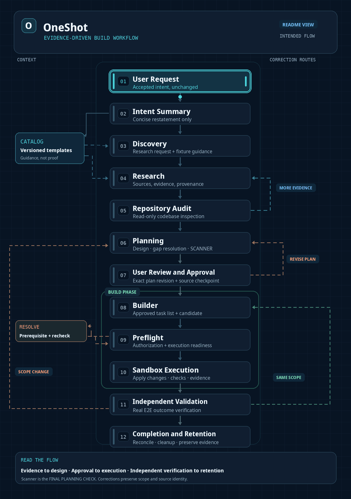

# OneShot

**Evidence-driven software engineering, from user request to independently verified implementation.**

OneShot organizes Discovery, Research, Repository Audit, Planning, and Build through traceable evidence, exact user approval, isolated execution, and independent verification.

[](https://github.com/itz1508/OneShot/actions/workflows/ci.yml)
[](https://github.com/itz1508/OneShot/actions/workflows/mvp.yml)
[](https://github.com/itz1508/OneShot/actions/workflows/audit-capabilities.yml)

## Workflow



**[Standalone HTML workflow](docs/workflow.html)** — open the HTML file in a browser for a scalable vector view with pause/resume controls. The GIF and HTML show the same **intended architecture**, not an observed full runtime execution.

**Main sequence:** User Request → Intent Summary → Discovery → Research → Repository Audit → Planning → User Review and Approval → Builder → Preflight → Sandbox Execution → Independent Validation → Completion and Retention.

Catalog is supporting memory that supplies versioned templates to **Discovery and Research**; templates guide expectations but do not prove success. Audit can request more evidence from Research. Scanner is the **final operation inside Planning**, not an additional workflow stage. Builder, Preflight, and Sandbox Execution together form the Build phase.

## Stage responsibilities

| Stage | Responsibility | Handoff |
| --- | --- | --- |
| Intent Summary | Preserve the user's request without adding scope | Input summary |
| Discovery | Prepare research questions, required evidence, and fixture guidance | Research request |
| Research | Gather sourced evidence, contradictions, and unknowns | Research results |
| Repository Audit | Inspect actual source, contracts, dependencies, and tests; read-only | Findings and CodeIntent |
| Planning | Design, specify file actions, resolve gaps, and run final Scanner review | `BuildSpecification` |
| User Review and Approval | Review exact plan revision, starting source checkpoint, and approved actions | Bound approval |
| Builder | Prepare tasks and implementation changes within approved scope | Build task list and candidate |
| Preflight | Check authorization, source identity, paths, dependencies, tools, and execution readiness | Authorized attempt |
| Sandbox Execution | Apply changes, run checks, capture observed effects, and export artifacts | Source result and execution evidence |
| Independent Validation | Verify the resulting source and real behavior against accepted requirements | Independent verification results |
| Completion and Retention | Reconcile attempts, clean resources, and retain trustworthy evidence | Completion record |

## Planning and Scanner

Planning follows **Code Review → Design and Refactoring → Implementation Plan → Gap Analysis → Gap Resolution → Scanner**.

Scanner identifies structural inconsistency—including overlap, duplication, ownership conflicts, drift, and missing contracts—across the eight issue categories defined by `PlanningIssue`:

| Category | Concern |
| --- | --- |
| Compatibility | Conflicting behavior, versions, or contracts |
| Dependency | Missing, circular, or conflicting dependencies |
| Interface | Inconsistent APIs, schemas, or producer/consumer handoffs |
| Concurrency | Race conditions, ordering, or conflicting operations |
| Security | Authorization, permissions, and unsafe effects |
| Recovery | Interruptions, retries, and uncertain side effects |
| Buildability | Missing actions, unsupported tools, or blockers |
| Verifiability | Missing fixtures, checks, criteria, or evidence |

**Scanner reports; Planning resolves.** Material findings prevent the candidate from advancing. Document unresolved or accepted-risk items with evidence and disposition; repeat the relevant checks when a revision changes the candidate. The current Scanner gateway declares six technical capabilities, so automated coverage of all eight Planning issue categories must not be assumed.

## Execution contract and artifacts

User approval is bound to the **exact plan revision and starting source checkpoint**, including authorized requirements, file paths, actions, dependencies, tools, and verification criteria. Changes produced *within* those authorized boundaries do not invalidate the initial approval; changes to the plan, starting source identity, or approved scope require renewed review.

Builder prepares the approved task list and candidate. Host-managed authorization and Preflight check the exact inputs before execution; unresolved prerequisites prevent Sandbox creation. Each authorized build attempt runs in a disposable Sandbox. The standalone Modal Sandbox exports:

| Artifact | Contents |
| --- | --- |
| `result.json` | Structured execution results |
| `after.tar` | Resulting source tree |
| `evidence.zip` | Execution logs and evidence |
| Attempt state | Execution identity, lifecycle, and recovery history |

Each handoff must bind producer, consumer, originating request, schema revision, and relevant source or plan identity. Fixture guidance starts in Discovery, is refined with evidence and repository findings, and becomes concrete checks in Planning and Validation; guidance alone is not executed evidence.

## Validation, correction, and completion

Independent Validation examines **the resulting source and observed application behavior**, not the Builder's self-reported success. Pre-existing baseline failures must remain distinguishable from failures introduced by a candidate.

| Condition | Continuation |
| --- | --- |
| Repository Audit requires more evidence | Research → Repository Audit |
| User revises the plan | Planning → User Review and Approval |
| Preflight prerequisite is unresolved | Resolve prerequisite → repeat Preflight |
| Validation identifies a correction **within approved requirements, design, paths, actions, dependencies, and tools** | Builder → Preflight → new Sandbox attempt → Validation |
| Validation requires a changed scope or source starting checkpoint | Planning → renewed User Review and Approval |
| An attempt is interrupted or its effects are uncertain | Reconcile the attempt before continuing |

Completion requires independent evidence for accepted requirements, accounted-for tasks and checks, recorded final source identity, reconciled attempts, cleanup of temporary Sandboxes, and retained execution and verification artifacts. Only verified reusable knowledge is eligible for promotion.

## Implementation status

**Intended workflow:** The diagram and narrative above describe the target experience. **Declared workflow:** [`.agents/contracts/workflow.yaml`](.agents/contracts/workflow.yaml) currently registers Research → Audit Discovery → Planning → Fixture Validation → Build → Build Validation, plus internal structural checks, specification freeze, package lock, Build Admission, and integration operations. These implementation mechanisms are not additional user-facing stages.

The current React/Vite and FastAPI MVP supports task input, persistence, SSE, MCP-backed Research integration, controlled input updates, and a separate read-only Audit capability. A connected Discovery-first workflow and complete Build-to-E2E execution have **not** been verified. The [standalone Modal Sandbox](deployment/modal/sandbox_v3/README.md) has a separate integration boundary. Claims of working behavior must refer to the actual tested revision and evidence.

## Get started

Requires Python 3.11+, [uv](https://docs.astral.sh/uv/), and Node.js/npm. From the repository root:

```sh
uv sync --locked --extra meta --extra mvp
uv run --no-sync python -m agent doctor
uv run --no-sync uvicorn mvp.api:app --host 127.0.0.1 --port 8000
```

In a second terminal:

```sh
cd web
npm ci
npm run dev
```

Open `http://127.0.0.1:5173`. For MCP-backed Research, configure `ONESHOT_MCP_COMMAND` and `ONESHOT_MCP_ARGS_JSON` for stdio, or `ONESHOT_MCP_URL` for HTTP. See [Research integration](mvp/README.md#research-integration). Do not expose the development API publicly or commit credentials.

## Verification

```sh
uv lock --check
uv run --no-sync ruff check .
uv run --no-sync ruff format --check .
uv run --no-sync mypy agent
uv run --no-sync pytest -q
```

Browser checks require Playwright Chromium:

```sh
cd web
npm ci
npx playwright install chromium
npm run build
npm run test:browser
```

Browser tests use deterministic MCP fixtures; they do not prove live-model operation. See [GitHub Actions](https://github.com/itz1508/OneShot/actions) for recorded CI runs.

## Repository guide

[`AGENTS.md`](AGENTS.md) · [Workflow contract](.agents/contracts/workflow.yaml) · [`agent/contracts/`](agent/contracts/) · [`agent/runtime/`](agent/runtime/) · [`agent/audit/`](agent/audit/) · [`mvp/`](mvp/) · [`web/`](web/) · [`tests/`](tests/) · [`deployment/modal/`](deployment/modal/)

**Canonical repository:** [itz1508/OneShot](https://github.com/itz1508/OneShot) · `main`
