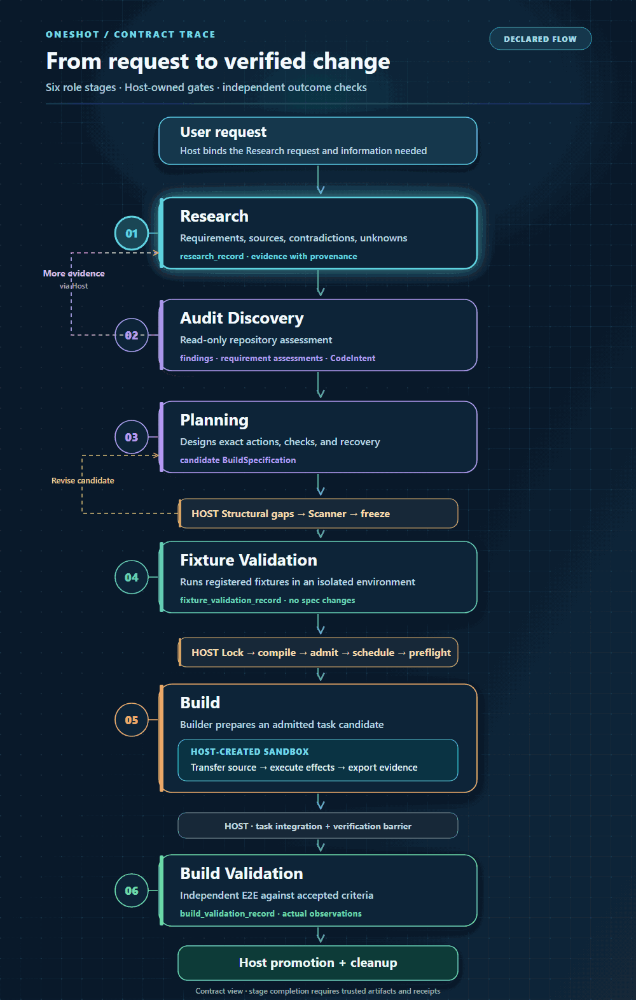

# OneShot

**Evidence-driven AI software engineering with host-controlled execution.**

OneShot organizes software work into an auditable workflow, separating model-generated reasoning from permission to modify files, advance stages, or claim completion.

[](https://github.com/itz1508/OneShot/actions/workflows/ci.yml)
[](https://github.com/itz1508/OneShot/actions/workflows/mvp.yml)
[](https://github.com/itz1508/OneShot/actions/workflows/audit-capabilities.yml)

## How it works

[](docs/workflow-overview.gif)

[Open the animated GIF at full size](docs/workflow-overview.gif) · [View the static, accessible diagram](docs/workflow-overview.svg)

The registered role order is **Research → Audit Discovery → Planning → Fixture Validation → Build → Build Validation**. The narrow amber bands show Host operations between stages; the Build card contains the Host-created sandbox boundary. The dashed arrows show the contract's Research follow-up and Planning correction routes.

The **Host** controls authorization, immutable artifacts, tool identity, stage transitions, and receipts. This diagram describes the registered contract; it does not claim a completed live six-stage run.

> **Documentation-only clarification:** This README and its diagram assets changed. Application code, workflow contracts, configuration, and execution behavior did not change.

### Core design

- **Typed contracts:** Python 3.11+, Pydantic v2, and cross-stage validation.
- **Evidence and provenance:** RFC 8785 canonical serialization, SHA-256 digests, content-addressed artifacts, and host-issued receipts.
- **Execution boundaries:** default-deny authorization, allowed-path checks, pinned tool identities, and host-controlled Build Admission.
- **Recovery:** persisted checkpoints, compare-and-swap updates, and explicit reconciliation of interrupted effects.
- **Model integration:** Meta Muse Spark is the configured default profile; provider adapters keep model inference separate from execution authority. Echo is for testing.

## Current application

The working **React/Vite System Chat + FastAPI MVP** offers task submission, persisted state, streamed events (SSE), artifact inspection, controlled input revision, MCP-backed Research, a separate read-only repository Audit capability, and connection settings.

**Scope boundary:** The MVP is a real host-backed application slice, not a complete six-stage agent execution product. Audit is separate from the Audit Discovery stage. Planning, Fixture Validation, and Build do **not** currently have MVP HTTP execution routes. Browser tests use deterministic MCP fixtures; these do not prove live model output or external MCP-server connectivity.

See [MVP documentation](mvp/README.md) for configuration, security boundaries, and integration evidence.

## Get started

Requires [uv](https://docs.astral.sh/uv/), Python 3.11+, and Node.js/npm for the web UI.

**1. Install the backend (repository root)**

```sh
uv sync --locked --extra meta --extra mvp
uv run --no-sync python -m agent doctor
```

**2. Start the local API**

```sh
uv run --no-sync uvicorn mvp.api:app --host 127.0.0.1 --port 8000
```

**3. Start the frontend (second terminal)**

```sh
cd web
npm ci
npm run dev
```

Open **http://127.0.0.1:5173**. The development server proxies `/api` to the local FastAPI backend.

To run Research, configure the host-owned MCP transport (`ONESHOT_MCP_COMMAND` and `ONESHOT_MCP_ARGS_JSON` for stdio, or `ONESHOT_MCP_URL` for HTTP). A health response means the API is reachable; it does **not** establish an active MCP connection. See [MCP Research setup](mvp/README.md#research-integration).

> Do not expose the development API publicly or commit model/API credentials. The operator owns runtime configuration and secrets.

## Verify

```sh
uv lock --check
uv run --no-sync ruff check .
uv run --no-sync ruff format --check .
uv run --no-sync mypy agent
uv run --no-sync pytest -q
```

Browser E2E requires Playwright Chromium:

```sh
cd web
npm ci
npx playwright install chromium
npm run build
npm run test:browser
```

The browser suite exercises Research through a deterministic MCP fixture, the read-only Audit path, task persistence, and connector UI. CI results are recorded in [GitHub Actions](https://github.com/itz1508/OneShot/actions); local and live-provider verification must be run separately.

## Repository guide

| Location | Purpose |
| --- | --- |
| [`agent/contracts/`](agent/contracts/) | Stage, host, scanner, and validation contracts |
| [`agent/runtime/`](agent/runtime/) | Controller, artifact/receipt stores, admission, effects, recovery |
| [`agent/audit/`](agent/audit/) | Read-only repository auditing |
| [`mvp/`](mvp/) | FastAPI MVP and MCP Research adapter |
| [`web/`](web/) | React System Chat and Playwright tests |
| [`tests/`](tests/) | Contract, fixture, security, and workflow tests |
| [`deployment/modal/`](deployment/modal/) | Standalone serverless deployment starter, not integrated Build execution |
| [`AGENTS.md`](AGENTS.md) | Contributor and workflow boundaries |

**Canonical source:** [itz1508/OneShot](https://github.com/itz1508/OneShot), `main`. Verification claims always refer to the exact tested revision.
